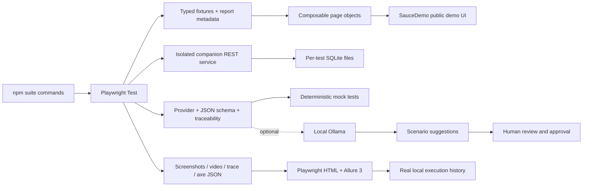
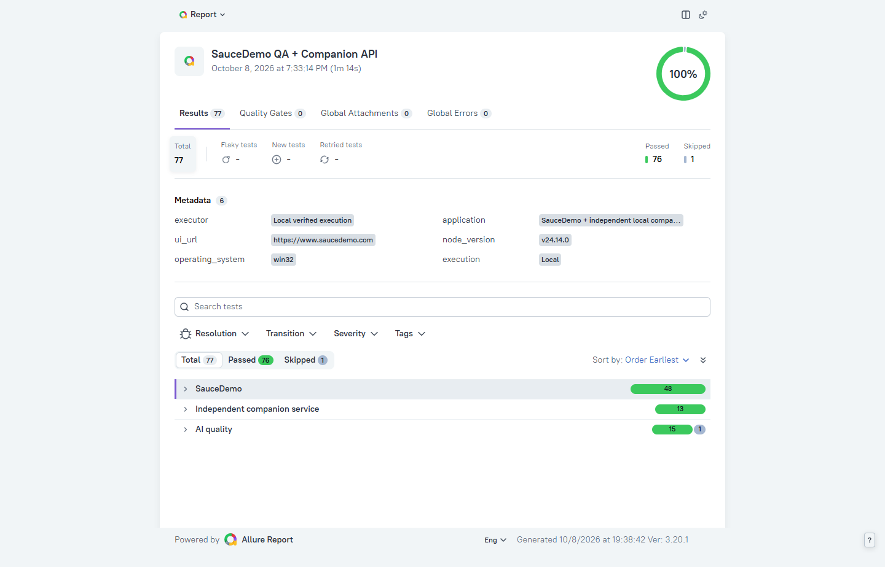

# Free AI-assisted Playwright QA framework

A Windows-friendly TypeScript test framework built against the **observed**
SauceDemo UI, with Allure 3 reports, an independent offline SQLite order API and
an optional local Ollama suggestion adapter. No paid service or cloud key is
required. The AI layer produces validated proposals for human review; it never
executes generated code.

## Architecture



## What is covered

The [test-case catalog](test-cases/README.md) documents all 79 automated cases
with steps, expected results, source links and saved execution outcomes.

- Authentication, negative credentials, password masking, keyboard input, logout and protected routes.
- Six-product catalog, complete details, image loading and all four actual sorting orders.
- Single/multiple cart items, badge/price identity, navigation and refresh persistence.
- Required checkout fields, boundary text, cancellation, displayed monetary arithmetic and confirmation.
- Actual lazy-load/spinner/slider catalog modes and a genuine demo-order PDF download.
- Desktop and 390×844 mobile flows; limited axe scans and two reviewed screenshot baselines.
- Separate persona defect reproductions, excluded from normal CI gates.
- Offline REST CRUD, error/schema validation and SQLite persistence tests.
- Schema-validated AI suggestions, deterministic negative adapter tests and explicit human approval data.

Source reconnaissance, scope decisions and exact execution evidence live in
[`docs/`](docs/application-inventory.md). Search, pagination, coupons, real
payments, uploads and SauceDemo backend/database assertions are not fabricated.

## Setup

Node **24** and npm are required. Verified locally with Node 24.14.0 and
Playwright 1.64.0. Dependencies are free, lockfile-backed npm packages.

```powershell
cd C:\QAProjects\ai-powered-playwright-qa-framework
npm ci
# Bundled Chromium for Linux CI/headless use:
npx playwright install chromium
npm run typecheck
npm run lint
npm test
```

On this Windows machine, headed bundled Chromium previously failed with
`spawn UNKNOWN`; installed Google Chrome launched successfully. Windows local
UI projects therefore use `channel: 'chrome'`. Install Google Chrome if running
this configuration on another Windows machine. CI uses bundled Chromium and
has no Windows-path dependency. No automatic browser reinstall workaround is used.
There is no `.git` directory in the current project folder; nothing was committed,
pushed or published. The existing ISC package license declaration is retained;
no new MIT license or licensing decision was made.

## Commands and test matrix

| Command                                      | Scope                                                           | Default quality gate  |
| -------------------------------------------- | --------------------------------------------------------------- | --------------------- |
| `npm test`                                   | Desktop/mobile regression + offline API + AI (live check skips) | Local complete gate   |
| `npm run test:ci`                            | Smoke + API + deterministic AI, one combined report             | Push/PR               |
| `npm run test:smoke`                         | Six critical desktop/mobile cases                               | Push/PR subset        |
| `npm run test:regression`                    | 38 desktop/mobile functional cases                              | Manual/weekly CI      |
| `npm run test:negative`                      | 15 meaningful invalid/boundary cases                            | Regression subset     |
| `npm run test:login:headed`                  | Existing login, visible Chrome                                  | Local                 |
| `npm run test:api`                           | 13 offline REST/SQLite cases                                    | Push/PR               |
| `npm run test:ai`                            | 15 deterministic provider/schema cases                          | Push/PR               |
| `npm run test:ai:live`                       | Opt-in live local Ollama evaluation                             | No                    |
| `npm run test:known-defects`                 | Three evidence-based defect reproductions                       | No                    |
| `npm run test:personas`                      | Performance persona + known defects                             | No                    |
| `npm run test:accessibility`                 | Four scoped axe audits + keyboard focus                         | No, separate audit    |
| `npm run test:visual`                        | Two OS-specific screenshot comparisons                          | No                    |
| `npm run test:visual:update`                 | Explicit baseline update; review PNGs afterwards                | Never automatic in CI |
| `npm run test:examples`                      | Preserved Playwright starter tests                              | No                    |
| `npm run test:cross-browser`                 | Optional Firefox/WebKit functional runs                         | No                    |
| `npm run companion:start`                    | Loopback companion development server                           | Offline/local         |
| `npm run ai:suggest`                         | Labelled mock scenario suggestion workflow                      | No code execution     |
| `npm run ai:suggest:live`                    | Optional local Ollama suggestions                               | No code execution     |
| `npm run ai:approve -- .local/approval.json` | Human-authored selection → approved data                        | No code execution     |

Counts are cases, not assertions; smoke/negative are subsets and should not be
added to regression counts. Firefox/WebKit require a separate
`npx playwright install firefox webkit` and were not executed during this build.
Current verified outcomes and limitations: [`execution-results.md`](docs/execution-results.md).

## Reports

`npm run test:portfolio` explicitly collects all functional, API, AI, audit,
visual and known-defect suites in one run. It is separate from the default CI
gate, uses existing reviewed baselines and leaves the live local model opt-in.

```powershell
npm run allure:clean
npm test
npm run allure:generate
npm run allure:open
# Native report:
npx playwright show-report
```

Allure CLI **3.20.1** is verified locally. Raw results accumulate until explicitly
cleaned, allowing separate suites to share a report. Clean at the start of a new
collection, and generate once per real execution collection. Allure history uses
JSONL, not Allure 2's history directory. Screenshots/videos/traces are retained
on failures; passing known-defect checks attach reproduction evidence.
[Reporting details](docs/reporting.md) explain metadata, executor support, history
limits and CI artifact retention.

## Genuine visual evidence

These images were captured by the tests and visually inspected, not generated mockups.



[Login baseline](tests/visual/baselines/win32/visual/visual/screens.spec.ts/login.png) ·
[Inventory baseline](tests/visual/baselines/win32/visual/visual/screens.spec.ts/inventory.png)

For an explicit report UI verification, serve it with
`npm run allure:open -- --port 5057`, then in another terminal run
`npm run allure:verify`. The verifier captures actual local dashboard evidence;
it does not create test outcomes or historical runs.

Baselines are partitioned by OS and project. Only Windows baselines are supplied.
`test:visual` refuses baseline creation; another OS needs an explicit reviewed
baseline update. Screenshots use a fixed viewport, locale, timezone, color scheme,
loaded images/fonts and disabled animations. Different Chrome versions can still
change rendering; this is not cross-browser visual equivalence certification.

## CI and engineering

The existing `.github/workflows/playwright.yml` is improved rather than duplicated.
It uses Node 24, `npm ci`, strict typechecking, ESLint, Prettier, Chromium only,
one test worker, and a combined smoke/API/AI gate. Manual dispatch and a modest
Monday schedule add broader UI regression. Workflow permissions are read-only.
Evidence uploads run even when tests fail, with 14-day retention; gate HTML is
saved before regression can replace the latest HTML report. GitHub Actions was
not remotely executed from this folder, so no remote green badge/status is claimed.
No GitHub Pages or other publishing is configured.

TypeScript uses strict mode and unchecked-index protection. Page objects use
role/data-test locators, native `selectOption`, retrying assertions, isolated
contexts and integer cents. No fixed sleeps, force clicks or generated-code
execution. Optional AI has a loopback-only provider, constrained request timeout,
schema validation, deduplication and requirement traceability.

## Limitations and interview discussion

This is an evidence-driven portfolio framework, not exhaustive production
certification. Public-site changes and network outages can affect UI runs.
Accessibility automation covers only selected stable pages/tags; manual assistive
technology testing remains necessary. The companion API is deliberately separate
from SauceDemo and has no production security/scaling claim. Node SQLite emits
an experimental warning on the verified runtime. A real Ollama model has not
been evaluated during this build, and the framework does not promise a specific
model fits 8 GB RAM.

Discuss in interviews: selecting observable requirements rather than inventing
coverage; test isolation without shared login state; sorting/financial oracles;
product vs framework vs environment failures; reproducible defects outside the
CI gate; independent offline API fixtures; trusted schemas around untrusted model
output; and genuine report history without synthetic runs.

Further reading: [test plan](docs/test-plan.md), [traceability](docs/requirements-traceability.md),
[coverage](docs/coverage-matrix.md), [defects](docs/defect-reports.md),
[local API](docs/companion-api.md), [AI workflow](docs/ai-workflow.md).

## AI scenario quality and correction

Generation validates the existing schema, then checks quality and requirement traceability. Adjacent punctuation/case/whitespace-equivalent repeated assertions are deterministically removed only when no action or distinct assertion separates them; every repair is recorded before/after. Local Ollama defaults to `qwen2.5:1.5b` (override with `OLLAMA_MODEL`). Corrections target one invalid scenario at a time, at most once per scenario, and may only remove existing steps; IDs, title, expected result, priority and requirement mapping are immutable. Uncertain cases remain for human editing. Valid scenarios can be approved independently while needs-fix scenarios remain blocked.

Run `npm run ai:suggest` for deterministic mock mode or `npm run ai:suggest:live` for local Ollama. Inspect `.local/scenario-suggestions.json`, `.local/scenario-quality-report.json`, `.local/scenario-correction-history.json` and `.local/scenario-repair-audit.json`, all already ignored by Git. Approve with `npm run ai:approve -- .local/approval.json` using a human-authored reviewer and ID selection; selected scenarios with blocking errors are refused. No tests are generated or executed. See [AI workflow](docs/ai-workflow.md) for setup, correction rules and limitations. Heuristics cannot conclusively validate business logic or supported functionality.

## PRD-assisted automation

The local PRD interface now supports application inspection, static POM discovery, bounded TypeScript generation, individual code approval, selected execution and requirement traceability. See [the workflow guide](docs/PRD-AUTOMATION.md) for commands, the configurable sample and supported scope.
